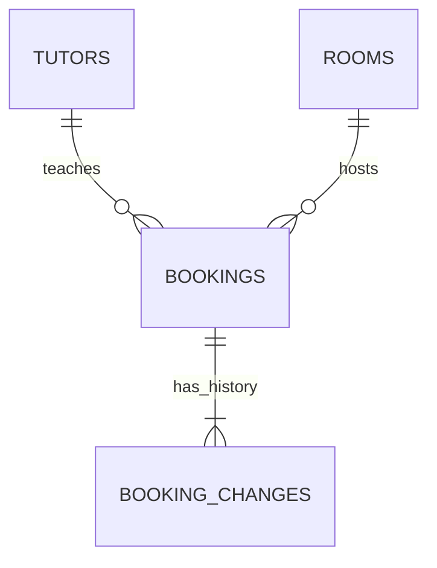

# Database design

This is the SQLite design for Bright Path Booking Management. The schema and seed-import workflow are implemented under `src/db`; the API service responsibilities below describe the planned booking workflow. See `README.md` for reproducible setup and verification commands.

The design follows `DECISIONS.md` and the architecture, API, and UI skills. For HTTP behavior, use the skills' refined contract: `/api/v1`, cancellation through `PATCH /bookings/{id}`, and `412 Precondition Failed` for a stale `If-Match`.

## 1. Scope and conventions

- Four tables: `tutors`, `rooms`, `bookings`, and `booking_changes`.
- Preserve all supplied CSV records, including scheduling violations, original lesson IDs, names, notes, and supplied cancellation timestamps. CSV empty optional values become SQL `NULL`; the source files remain untouched.
- Booking `date` and `start_time` represent local wall time in `Asia/Ho_Chi_Minh`. Dates use `YYYY-MM-DD`; times use `HH:mm`.
- New audit and cancellation timestamps are ISO 8601 instants in UTC. Imported `cancelled_at` values retain their original explicit offset. Compare timestamps as instants, not as raw strings with different offsets.
- Derive a booking's full start instant from its local date/time and its end instant by adding `duration_min`. Do not store `end_time` separately.
- Use an injectable clock with a pinned reference instant in the seed period for reproducible demos. Do not use SQLite's real-time `CURRENT_TIMESTAMP` for demo-dependent business decisions.
- A booking represents one named student with one tutor in one room. Paired lessons are not a supported new-booking model.

## 2. Tables and relationships



Each booking references exactly one existing tutor and room. A tutor or room can have many bookings. Every imported or newly created booking receives a baseline history record; subsequent accepted changes append more records.

The one-or-more history relationship is an application invariant: a foreign key only guarantees that each history record belongs to a booking, not that each booking has history.

### `tutors`

| Column | SQLite type | Nullability / default | Purpose and database constraints |
|---|---|---|---|
| `tutor_id` | `TEXT` | Required | Primary key; nonblank, e.g. `T1` |
| `tutor_name` | `TEXT` | Required | Nonblank display name |
| `subject` | `TEXT` | Required | Nonblank imported subject |
| `phone` | `TEXT` | Required | Nonblank imported contact text; preserve leading zeroes and masked values such as `090xxx1122` |

Names, subjects, and phone numbers are not unique. Do not apply a numeric phone constraint: the supplied contacts are masked. Tutor administration is outside this MVP.

### `rooms`

| Column | SQLite type | Nullability / default | Purpose and database constraints |
|---|---|---|---|
| `room_id` | `TEXT` | Required | Primary key; restricted to `R1`, `R2`, `R3`, `R4`, `R5`, `R6` |

Seed all six rooms, including rooms absent from the lessons CSV. The room list is fixed reference data; no room-management API is required.

### `bookings`

| Column | SQLite type | Nullability / default | Purpose and database constraints |
|---|---|---|---|
| `lesson_id` | `TEXT` | Required | Nonblank primary key; preserve imported `L001`–`L034` |
| `date` | `TEXT` | Required | Local lesson start date; database checks date shape, service validates a real calendar date |
| `start_time` | `TEXT` | Required | Local lesson start time; database checks `00:00`–`23:59` format |
| `duration_min` | `INTEGER` | Required | Stored integer; only `60` or `90` |
| `student` | `TEXT` | Required | Nonblank student name; not unique |
| `tutor_id` | `TEXT` | Required | Foreign key to `tutors.tutor_id` |
| `room` | `TEXT` | Required | Foreign key to `rooms.room_id`; retain the CSV/API field name |
| `status` | `TEXT` | Required; `booked` | One of `booked`, `cancelled`, `no_show` |
| `cancelled_at` | `TEXT` | Nullable | Required and nonblank exactly when status is `cancelled`; otherwise `NULL` |
| `note` | `TEXT` | Nullable | Original note or staff-entered text; never interpreted as a rule override |
| `version` | `INTEGER` | Required; `1` | Positive stored integer for concurrency control |

`lesson_id` remains stable for edits and same-room rescheduling. New IDs are generated server-side, for example `B-<UUID>`, avoiding collisions with imported IDs; the primary key is the final uniqueness guard. Do not generate IDs using an unlocked `MAX(id) + 1` read.

Student matching uses the exact stored name, with case-sensitive equality. Trim new user input before storing it, but do not rewrite imported names. This is a working MVP identity policy: different people sharing a name cannot be distinguished, and spelling variations can evade conflict matching. No student table or fabricated student IDs are introduced.

### `booking_changes`

| Column | SQLite type | Nullability / default | Purpose and database constraints |
|---|---|---|---|
| `id` | `INTEGER` | Required | Primary key generated by SQLite |
| `lesson_id` | `TEXT` | Required | Foreign key to `bookings.lesson_id` |
| `action` | `TEXT` | Required | `imported`, `created`, `updated`, or `cancelled` |
| `changed_at` | `TEXT` | Required | Nonblank ISO 8601 instant; service/importer validates and supplies it |
| `before_snapshot` | `TEXT` | Nullable | JSON object; `NULL` for baseline actions, required for updates/cancellations |
| `after_snapshot` | `TEXT` | Required | JSON object containing the full saved booking state |
| `reason` | `TEXT` | Nullable | Required and nonblank for `updated` and `cancelled`; optional for baseline actions |
| `needs_manual_communication` | `INTEGER` | Nullable | `0` or `1` for live mutations; `NULL` for imported baselines because historical communication is unknown |

Snapshots include all booking columns, including `version`, `note`, and `cancelled_at`. The service verifies that snapshot identity and values match the actual before/after records. The database verifies JSON object structure, not the semantic accuracy of those snapshots.

An `imported` record captures the initial loaded state. Its `changed_at` is the import time, not a fabricated historical edit time; its `before_snapshot` is `NULL`. The CSV provides neither earlier snapshots nor notification history.

## 3. Proposed database definition

The SQL below makes the table constraints concrete. It assumes SQLite JSON functions are available; connection initialization must verify that dependency. Text primary keys are explicitly `NOT NULL`.

```sql
PRAGMA foreign_keys = ON;

CREATE TABLE tutors (
    tutor_id   TEXT NOT NULL PRIMARY KEY CHECK (length(trim(tutor_id)) > 0),
    tutor_name TEXT NOT NULL CHECK (length(trim(tutor_name)) > 0),
    subject    TEXT NOT NULL CHECK (length(trim(subject)) > 0),
    phone      TEXT NOT NULL CHECK (length(trim(phone)) > 0)
);

CREATE TABLE rooms (
    room_id TEXT NOT NULL PRIMARY KEY
        CHECK (room_id IN ('R1', 'R2', 'R3', 'R4', 'R5', 'R6'))
);

CREATE TABLE bookings (
    lesson_id    TEXT NOT NULL PRIMARY KEY CHECK (length(trim(lesson_id)) > 0),
    date         TEXT NOT NULL CHECK (
        date GLOB '[0-9][0-9][0-9][0-9]-[0-9][0-9]-[0-9][0-9]'
    ),
    start_time   TEXT NOT NULL CHECK (
        start_time GLOB '[0-2][0-9]:[0-5][0-9]'
        AND substr(start_time, 1, 2) BETWEEN '00' AND '23'
    ),
    duration_min INTEGER NOT NULL CHECK (
        typeof(duration_min) = 'integer' AND duration_min IN (60, 90)
    ),
    student      TEXT NOT NULL CHECK (length(trim(student)) > 0),
    tutor_id     TEXT NOT NULL REFERENCES tutors(tutor_id)
        ON UPDATE RESTRICT ON DELETE RESTRICT,
    room         TEXT NOT NULL REFERENCES rooms(room_id)
        ON UPDATE RESTRICT ON DELETE RESTRICT,
    status       TEXT NOT NULL DEFAULT 'booked'
        CHECK (status IN ('booked', 'cancelled', 'no_show')),
    cancelled_at TEXT,
    note         TEXT,
    version      INTEGER NOT NULL DEFAULT 1
        CHECK (typeof(version) = 'integer' AND version >= 1),
    CHECK (
        (status = 'cancelled' AND cancelled_at IS NOT NULL
            AND length(trim(cancelled_at)) > 0)
        OR (status <> 'cancelled' AND cancelled_at IS NULL)
    )
);

CREATE TABLE booking_changes (
    id              INTEGER PRIMARY KEY,
    lesson_id       TEXT NOT NULL REFERENCES bookings(lesson_id)
        ON UPDATE RESTRICT ON DELETE RESTRICT,
    action          TEXT NOT NULL
        CHECK (action IN ('imported', 'created', 'updated', 'cancelled')),
    changed_at      TEXT NOT NULL CHECK (length(trim(changed_at)) > 0),
    before_snapshot TEXT CHECK (
        before_snapshot IS NULL OR
        CASE WHEN json_valid(before_snapshot)
            THEN json_type(before_snapshot) = 'object' ELSE 0 END
    ),
    after_snapshot  TEXT NOT NULL CHECK (
        CASE WHEN json_valid(after_snapshot)
            THEN json_type(after_snapshot) = 'object' ELSE 0 END
    ),
    reason          TEXT,
    needs_manual_communication INTEGER CHECK (
        needs_manual_communication IS NULL OR
        (typeof(needs_manual_communication) = 'integer'
            AND needs_manual_communication IN (0, 1))
    ),
    CHECK (
        (action IN ('imported', 'created') AND before_snapshot IS NULL)
        OR (action IN ('updated', 'cancelled')
            AND before_snapshot IS NOT NULL
            AND reason IS NOT NULL AND length(trim(reason)) > 0)
    ),
    CHECK (
        (action = 'imported' AND needs_manual_communication IS NULL)
        OR (action <> 'imported' AND needs_manual_communication IS NOT NULL)
    )
);

CREATE TRIGGER booking_changes_no_update
BEFORE UPDATE ON booking_changes
BEGIN
    SELECT RAISE(ABORT, 'Booking history is append-only');
END;

CREATE TRIGGER booking_changes_no_delete
BEFORE DELETE ON booking_changes
BEGIN
    SELECT RAISE(ABORT, 'Booking history is append-only');
END;

CREATE TRIGGER bookings_no_delete
BEFORE DELETE ON bookings
BEGIN
    SELECT RAISE(ABORT, 'Cancel bookings instead of deleting them');
END;

CREATE INDEX bookings_room_date_time
    ON bookings(room, date, start_time);
CREATE INDEX bookings_tutor_date
    ON bookings(tutor_id, date);
CREATE INDEX bookings_student_date
    ON bookings(student, date);
CREATE INDEX booking_changes_lesson_sequence
    ON booking_changes(lesson_id, id);
```

Enable and verify `PRAGMA foreign_keys = ON` for every connection before transactions. Do not rely on a setting on only the schema-creation connection. Foreign key enforcement is connection-specific. See [SQLite foreign keys](https://www.sqlite.org/foreignkeys.html).

The indexes support reads; they do not enforce availability. Do not add unique constraints on `(room, date, start_time)` or `(tutor_id, date, start_time)`: they would reject preserved seed duplicates and would still miss overlaps with different start times.

The database intentionally checks only the date's shape. The service must reject impossible dates such as `2026-02-30`. SQLite column affinity also does not replace strict request-type validation; reject invalid JSON types before persistence. See [SQLite table constraints](https://www.sqlite.org/lang_createtable.html).

Snapshot checks require [SQLite JSON functions](https://www.sqlite.org/json1.html). The append-only and no-delete protections use [SQLite triggers](https://www.sqlite.org/lang_createtrigger.html). They protect ordinary writes under the intact schema; they are not an authorization boundary against someone able to alter the database schema.

## 4. Constraint ownership

**DB** means SQLite enforces the invariant even if a normal repository write bypasses service validation. **Application** means the API service enforces it; direct SQL can violate it. **Both** means the service performs the necessary checks/orchestration and SQLite provides an additional guard. Frontend checks are usability aids and are never authoritative.

| Constraint / invariant | Layer | Database enforcement | API service enforcement |
|---|---|---|---|
| Unique, nonblank tutor/room/lesson identity | Both | Primary keys, `NOT NULL`, `CHECK` | Server-generated booking IDs; reject client identity changes |
| Existing tutor and one of six rooms | Both | Room `CHECK` and booking foreign keys | Resolve references and return actionable invalid-input errors |
| Required, nonblank student and reference text | Both | `NOT NULL` and nonblank checks | Validate request types and trim newly entered names |
| Valid date/time | Both, with different coverage | Date shape and valid `HH:mm` range | Real calendar date, input types, timezone interpretation |
| Duration is 60 or 90 minutes | Both | Integer/value `CHECK` | Reject unsupported duration before writing |
| Status is recognized | Both | Status `CHECK` | Validate supported lifecycle operation; new API bookings start as `booked` |
| Cancellation timestamp agrees with status | Both | Required only for `cancelled` | Set timestamp on cancellation; clear on any supported restoration; validate instant syntax |
| No student overlap | Application | No overlap constraint | Check occupying bookings by exact student name across every room |
| No tutor overlap | Application | No overlap constraint | Check occupying bookings for the tutor across every room |
| No room overlap | Application | No overlap constraint | Check occupying bookings for the destination room |
| Maximum six counted bookings per tutor per day | Application | No aggregate count constraint | Count `booked` and `no_show` on the local start date; exclude edited booking |
| Monday closure | Application | No weekday `CHECK` | Reject new or rescheduled occupying intervals on Monday; preserve imported records |
| Cancellation releases resources; no-show retains them | Application | Status values only | Use only `booked` and `no_show` in overlap and capacity queries |
| Same-room edits and drag invariants | Application | No trigger restricting room/duration changes | Reject room mutation; drag preserves duration/student/tutor; form may edit permitted fields |
| Positive version | Both | Positive integer `CHECK` | Initialize to 1 and increment exactly once per accepted mutation |
| Stale edits cannot overwrite newer state | Both | Atomic version-qualified `UPDATE` executed by SQLite | Validate ETag and require affected-row count of one; map stale precondition to `412` |
| Every saved mutation has accurate history | Both, cooperative | Transaction commits/rolls back booking and audit writes together | Supply matching snapshots, reason, action, and audit insert on the same connection |
| History snapshots are JSON objects | Both | JSON structure `CHECK` | Serialize full booking state and verify matching identity/version/values |
| Updated/cancelled history has reason and before state | Both | Conditional `CHECK` | Require a useful reason and load actual prior state |
| History cannot be updated/deleted | Both | Append-only triggers | Repository exposes append/read operations only |
| Bookings are retained after cancellation | Both | No-delete trigger and restricted foreign keys | Cancellation changes state; no hard-delete endpoint |
| Changes after schedule cut-off remain traceable | Application | Stores flag, timestamp, snapshots; checks flag domain only | Calculate cut-off impact from both old and new occupied intervals |
| Preserve historical scheduling anomalies | Application/importer | Scheduling restrictions deliberately absent | Import path bypasses scheduling checks; normal API mutations cannot use that bypass |

**Important limit:** a transaction does not automatically create history, increment a version, or detect overlaps. Service code must perform those operations. The schema does not prohibit an arbitrary direct SQL update that omits audit history or version handling.

## 5. Service validation and transaction flow

The booking service owns the transaction; repositories receive the same connection/transaction context. Never validate with one connection and persist with another.

For each create, edit, reschedule, or cancellation:

1. Validate request shape/types and parse date/time/instant values. Load required precondition information for edits.
2. Start `BEGIN IMMEDIATE` before reading competing bookings or the current booking version. SQLite permits one writer at a time; acquiring the write transaction before the checks prevents two requests from both checking an unreserved slot and then committing conflicting writes. Handle a busy database with a bounded wait/retry or a safe temporary-failure response. See [SQLite transactions](https://www.sqlite.org/lang_transaction.html).
3. Load the current booking for an edit. Verify `If-Match` against its version and reject an outdated value with `412`. Require the precondition for all API edits; a missing one returns `428`. These choices follow the API skill.
4. Build the complete candidate state from the existing record and allowed patch fields. Preserve `lesson_id`; reject a changed `room`. Only the importer can initialize imported statuses and history.
5. Validate the candidate's structural values and supported lifecycle operation. For an occupying create, restoration, or schedule/resource/duration change, enforce Monday closure, overlaps, and the daily count.
6. Write the booking. For updates use `WHERE lesson_id = ? AND version = ?`, set `version = version + 1`, and require exactly one affected row. On cancellation, set `status = 'cancelled'` and `cancelled_at` from the injected clock.
7. Append one history record with actual before/after snapshots, reason, timestamp, and computed communication flag. A creation uses `action = 'created'` and no before snapshot.
8. Commit only after both writes succeed. On any failure, roll back the entire transaction and return the appropriate API error.

Cancellation must remain possible for an imported conflicting or Monday booking: releasing resources does not require revalidating that booking's previous schedule. A note-only edit may preserve an unchanged historical anomaly. It still requires a version precondition and audit record. Changes to an occupying booking's schedule, student, tutor, or duration must satisfy current rules for the candidate; unrelated existing violations are not automatically repaired.

### Overlaps and daily counting

Use half-open intervals so consecutive lessons are allowed:

```text
existing.start_instant < candidate.end_instant
AND candidate.start_instant < existing.end_instant
```

- Only `booked` and `no_show` block resources and count toward the daily tutor limit. This is the explicit MVP counting assumption; paired-lesson counting remains an owner question.
- Exclude the edited `lesson_id` from conflict and count queries, then count the candidate once.
- Check tutor and student conflicts across all rooms, independent of the displayed room/week.
- Do not compare `HH:mm` strings alone. If an interval crosses midnight, include bookings on neighboring dates, evaluate the full instants, and apply Monday closure to every local date occupied by the candidate. A lesson ending exactly at Monday 00:00 does not occupy Monday.
- Attribute the daily tutor count to the booking's local start date. This is a documented working assumption for intervals crossing midnight, not an invented opening-hours rule.
- The UI's 30-minute snapping does not become a database or service requirement. No exact opening/closing hours are specified or enforced.

### Cut-off and communication tracking

For each local schedule date affected by the old or new occupying interval, its cut-off is **16:00 on the previous local day**. Mark `needs_manual_communication = 1` when the mutation occurs at or after any affected cut-off; otherwise use `0`. Treating exactly 16:00 as finalized is an explicit boundary convention for this design.

Rescheduling must consider both the removed slot and the new slot. Cancellation considers the old slot; creation considers the new slot. The flag belongs to the immutable change record, not the booking's current state, so later edits cannot erase an earlier communication requirement. Imported baselines use `NULL` because prior communication is unknown.

This flag records a need for staff follow-up. It does not record delivery, acknowledgement, or completion. No notification-history table, messaging integration, late-cancellation fee, or billing calculation is included.

### Room changes

Cancel the original booking with `reason = 'administrative_room_change'`, then create a new booking in the destination room. Each operation has its own transaction and audit record. If creation fails, the original remains cancelled; these two requests do not form an atomic transfer. No automatic cancellation charge is generated.

## 6. Seed import and verification

The dedicated importer loads tutors, seeds R1–R6, and loads bookings plus baseline history in one transaction. It validates structural integrity and foreign keys while bypassing only scheduling-policy checks. An unexpected structurally invalid CSV row aborts import with a clear error; it is not silently rewritten or dropped.

Use an explicit first-import-only policy: refuse import into a database that already contains bookings. Repeated application startup must not rerun import, overwrite staff changes, or duplicate baseline history. An explicit development database reset is a separate operation.

Expected baseline: **3 tutors, 6 rooms, 34 bookings, and 34 imported history records**. Every imported booking starts at `version = 1`; this is the application's baseline version, not a claim about spreadsheet revision history.

Preserve and verify these examples:

| Records | Expected result |
|---|---|
| L007/L008 | Both remain despite student overlap |
| L009/L010 | Both remain despite tutor/room overlap and paired-lesson notes |
| L018–L027 | T1 retains seven counted bookings on 2026-03-06 |
| L032 | Monday booking remains visible |
| L033/L034 | Tutor overlap across rooms remains visible |
| L005/L017 | Cancellation timestamps and notes remain intact; resources are released |
| L015 | `no_show` remains and continues to occupy its resources |

Implementation verification should cover direct SQL rejection of invalid durations/references/statuses and history mutation; service rejection of new overlaps, Monday bookings, and a seventh counted booking; successful cancellation of an anomalous imported booking; rollback when audit insertion fails; stale ETags; competing creates for the same resources; and cut-off impact on both sides of a reschedule.
